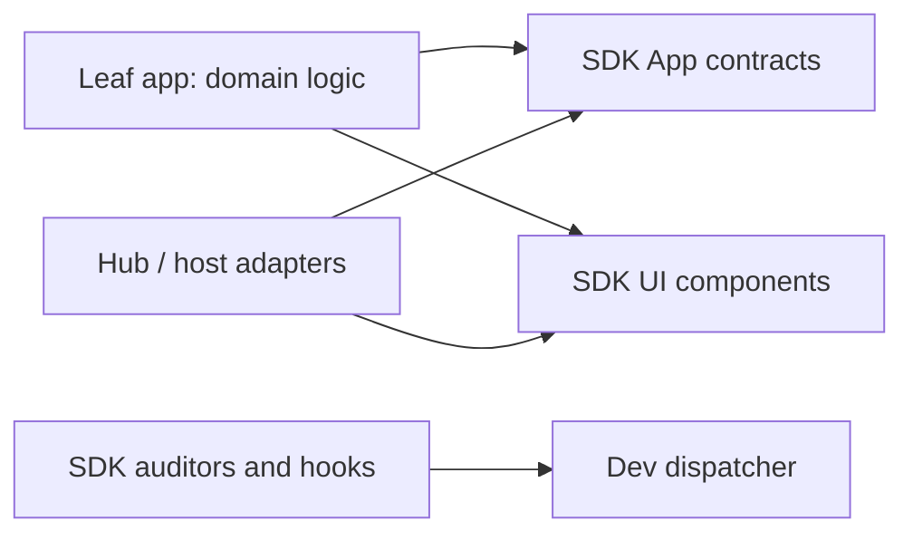

# SciTeX SDK (`scitex-sdk`)

<p align="center">
  <a href="https://scitex.ai"></a>
</p>

<p align="center"><b>Shared app contracts, UI components and host capabilities for SciTeX.</b></p>

<p align="center">
  <a href="src/scitex_sdk/_docs/APP_DEVELOPER_GUIDE.md">Full Documentation</a> · <code>pip install 'scitex-sdk[all]'</code>
</p>

<!-- scitex-badges:start -->
<p align="center">
  <a href="https://pypi.org/project/scitex-sdk/"></a>
  <a href="https://pypi.org/project/scitex-sdk/"></a>
  <a href="src/scitex_sdk/_docs/APP_DEVELOPER_GUIDE.md"></a>
</p>
<p align="center">
  <a href="https://github.com/scitex-ai/scitex-sdk/actions/workflows/python-package.yml"></a>
  <a href="https://github.com/scitex-ai/scitex-sdk/actions/workflows/python-package.yml"></a>
  <a href="https://github.com/scitex-ai/scitex-sdk/actions/workflows/frontend.yml"></a>
  <a href="#development-checks"></a>
</p>
<!-- scitex-badges:end -->

---

## Problem and Solution

| Problem | SDK capability |
|---|---|
| App headers, filters and layouts drift between applications. | Reuse the components, styles and contracts in `scitex_sdk.ui`. |
| A leaf application needs both standalone and hosted operation. | Use `scitex_sdk.app` contracts and host adapters; keep domain logic in the leaf. |
| Shared interface rules need an implementation owner. | SDK-owned auditors and hooks register with the `scitex-dev` dispatcher. |

## Quick Start

After [installation](#installation), inspect the bundled frontend and skill
namespaces without starting a server:

```python
from scitex_sdk import get_frontend_package_dir, list_bundled_skills

frontend = get_frontend_package_dir()
skills = list_bundled_skills()
print(frontend / "package.json")
print(sorted(skills))
```

The frontend directory contains the `@scitex/sdk` package manifest. The skill
namespaces are `scitex-app`, `scitex-sdk` and `scitex-ui`; this helper reads
bundled package resources, independently of user skill discovery.
For app development, follow the [App/UI contract](src/scitex_sdk/_docs/APP_DEVELOPER_GUIDE.md)
and the [SDK workflow skill](src/scitex_sdk/_skills/scitex-sdk/SKILL.md).

## Installation

Install the declared runtime capabilities:

```bash
uv pip install "scitex-sdk[all]"
```

<details>
<summary>Core and capability-specific installations</summary>

For Python helpers, CLI discovery and bundled resources alone:

```bash
pip install scitex-sdk
```

Choose the optional runtime dependencies needed by your application:

| Extra | Capability |
|---|---|
| `gui` | Django runtime for App/UI and the SDK GUI |
| `chat` | Chat providers |
| `mcp` | MCP server dependencies |
| `cli`, `project` | Dev-backed command and project tooling |
| `all` | All declared runtime capabilities |

<sub><b>Table 1.</b> Optional runtime capability extras.</sub>

```bash
pip install 'scitex-sdk[gui]'
# Or install all runtime capabilities:
pip install 'scitex-sdk[all]'
```

</details>

The App/UI implementations and frontend resources ship in the SDK itself;
extras install their optional dependencies. The `cli` and `project` extras,
and consequently `all`, require `scitex-dev>=0.62.6` for the declared provider
replacement SPI. Contributor dependencies use a separate dependency group;
see [Development checks](#development-checks).

## Architecture



<sub><b>Figure 1.</b> Leaves and hosts reuse SDK contracts and components; Dev dispatches SDK-owned checks.</sub>

The SDK owns the `scitex_sdk.app` and `scitex_sdk.ui` implementations, including
Django templates, static assets, translations and the packaged `@scitex/sdk`
frontend. Leaf apps own their GUI under `src/<leaf_pkg>/_django` and keep domain
logic and handlers in the leaf. Hub mounts apps through shared contracts and
supplies authorized host capabilities.

Shared header and filter components are defined by the
[header contract and browser checks](docs/ui/app-header-contract.md) and
[filter contract](docs/ui/filter-field-contract.md).

Dev owns generic interface discovery and dispatch. The SDK supplies Web API
descriptor checks through its `PS-SDK-WEB` project auditor and hooks. A host
must explicitly admit a descriptor before resolving handlers; source
declarations, installed providers and reachable endpoints are separate
observations. See [Web API contract enforcement](src/scitex_sdk/app/_skills/scitex-app/24_web-api-contract.md).

## Five Interfaces

| Interface | Discover the SDK surface |
|---|---|
| Python | `scitex_sdk.app`, `scitex_sdk.ui`, `scitex_sdk.project`; `scitex-sdk list-python-apis --json` |
| CLI | `scitex-sdk --help`, then `app --help` or `ui --help` |
| MCP | `scitex-sdk mcp list-tools` for the tool catalog |
| Web API | The `scitex.apis` entry point names an `ApiPlugin` data object; inspect its `openapi_fragment()` in a trusted SDK environment |
| Skills | `scitex-sdk skills list --json` and the installed `scitex_dev.skills` providers |

<sub><b>Table 2.</b> SDK interface discovery; host admission and live availability are checked separately.</sub>

The `scitex.cli` declaration exposes only `sdk`, using the same
`scitex_sdk.cli:main` target as the public console script. App/UI remain
subgroups of that command. Python, MCP, Web API and skill discovery use their
own declarations and admission rules.

The SDK declares an opt-in read-only Web `skills` operation over its bundled
SDK/App/UI documentation. Python callers can use `list_bundled_skills()`
directly; neither resource discovery nor a descriptor enables a hosted route.
See the [Python API catalog](src/scitex_sdk/_skills/scitex-sdk/03_python-api.md).

## Environment Variables

Settings are consumed by the feature that reads them. For example, the
[App CLI](src/scitex_sdk/app/_cli/_app.py) declares:

| Variable | Reader and scope |
|---|---|
| `SCITEX_SERVER_URL` | `app install-dev` and `app submit` server URL; explicit `--server` wins, otherwise the default is `http://127.0.0.1:8000`. |
| `SCITEX_API_TOKEN` | Token for those commands; an explicit `--token` overrides it. Authentication and host permissions remain server responsibilities. |

<sub><b>Table 3.</b> Environment variables declared by the App CLI.</sub>

The root/App/UI command-group callbacks do not consume a generic YAML
configuration chain. Standalone launchers and individual features have their
own readers and options; inspect the command you intend to run with `--help`.
App/UI Django settings, such as `SCITEX_UI_ELEMENT_INSPECTOR`, are distinct
from environment variables.

## Development checks

In a virtual environment with pip 25.1 or newer, install the declared
contributor group from the checkout:

```bash
python -m pip install -e . --group dev
python -m pytest tests/ -q -ra
```

Run the strict access controls against the owned in-memory SQLite fixture:

```bash
SCITEX_ACCESS_STRICT=1 python -m pytest tests/scitex_sdk/app/test_access_django.py tests/scitex_sdk/app/api_access/test___init__.py -q
```

The [package workflow](.github/workflows/python-package.yml) tests source and
built-wheel installations and runs `pip check`. The
[frontend workflow](.github/workflows/frontend.yml) checks TypeScript, lint,
component tests and browser contracts. Each CI badge represents its whole
workflow. The docs badge links to checked-in documentation. Coverage upload
is not configured in these workflows, so the `cov` badge says **not published**.
Test counts, passing CI and documentation builds do not establish coverage
percentages or hosted visual acceptance.

The Quick Start's resource behavior is covered by the
[bundled-skills controls](tests/scitex_sdk/test__bundled_skills.py).
The [CLI controls](tests/test_cli_root.py),
[Web descriptor controls](tests/scitex_sdk/_web/test__api.py) and
[read-only Web controls](tests/scitex_sdk/_web/test__views.py) cover their
respective discovery and admission boundaries.

## Migration from App and UI

Migration changes imports to `scitex_sdk.app/ui` and resource prefixes to
`scitex_sdk/app/` and `scitex_sdk/ui/`. Existing Django database labels,
template blocks and App/UI settings retain their identity. Start with
[Migration from App and UI](docs/MIGRATION_FROM_APP_AND_UI.md).
The predecessor [App](https://github.com/scitex-ai/scitex-app) and
[UI](https://github.com/scitex-ai/scitex-ui) repositories are public archives.

The SDK declares replacement of the legacy UI linter provider (UI-101..114);
Dev owns provider registration. Standalone SDK UI use keeps Dev optional.
See [provider transition](docs/UI_LINTER_PROVIDER_TRANSITION.md).
Consumer migration and strict published dependency retirement remain separate
checks; transitive predecessor packages can still make retirement incomplete.
See the [release sequence](docs/RELEASE_BOOTSTRAP.md).

## Part of SciTeX

`scitex-sdk` is part of [**SciTeX**](https://scitex.ai).

>Four Freedoms for Research
>
>0. The freedom to **run** your research anywhere — your machine, your terms.
>1. The freedom to **study** how every step works — from raw data to final manuscript.
>2. The freedom to **redistribute** your workflows, not just your papers.
>3. The freedom to **modify** any module and share improvements with the community.
>
>AGPL-3.0 — because we believe research infrastructure deserves the same freedoms as the software it runs on.

License: [AGPL-3.0-only](LICENSE).

---

<p align="center">
  <a href="https://scitex.ai"></a>
</p>
